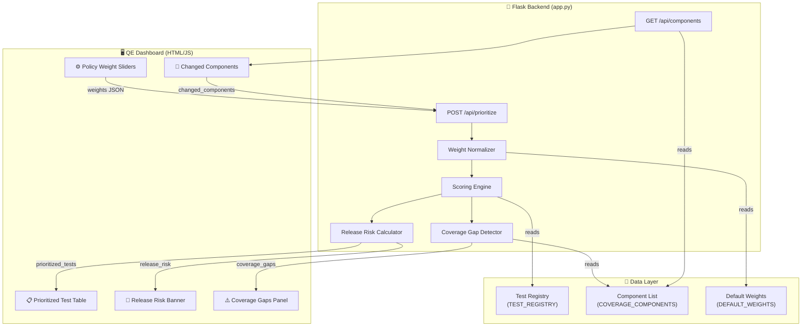
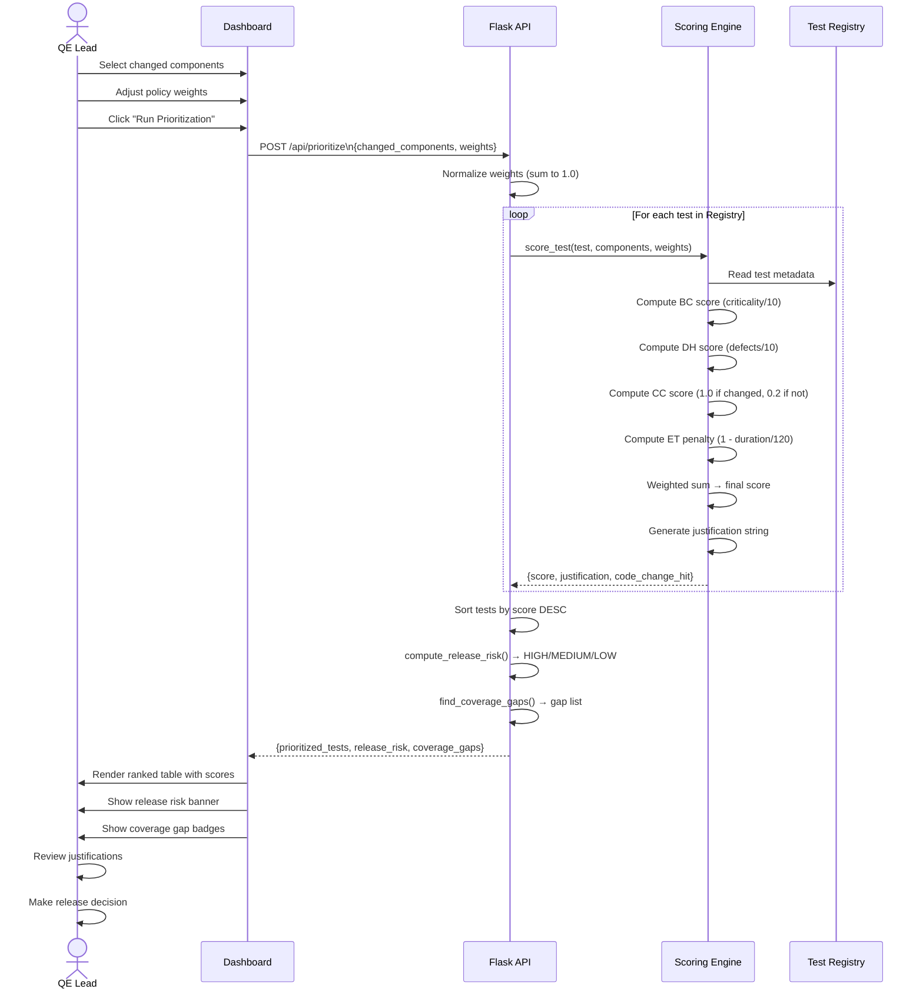
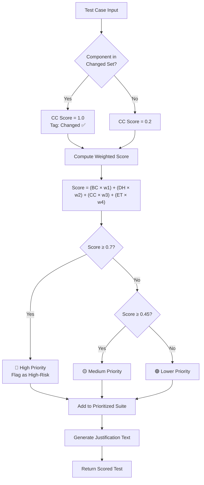
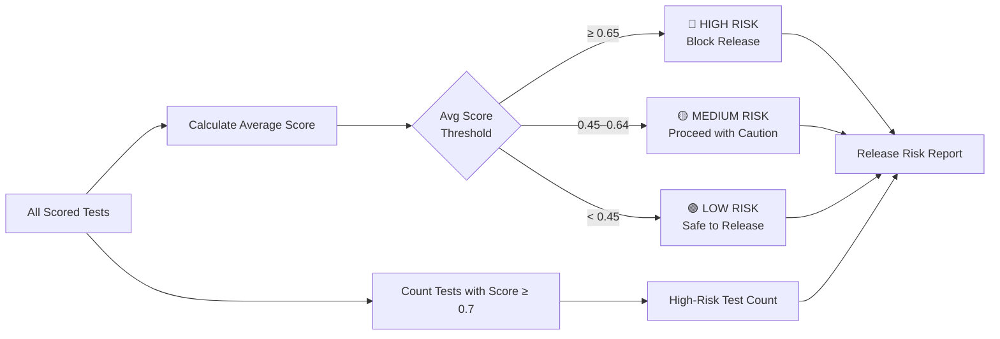
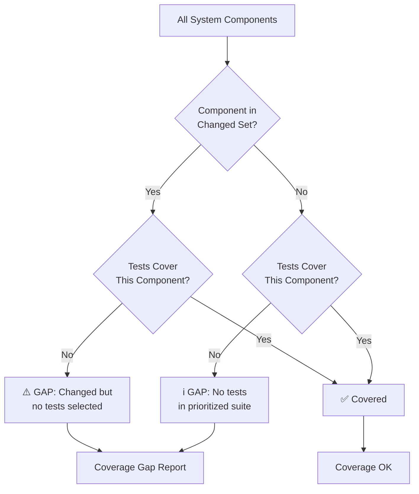

# 🧪 AI-Powered Regression Test Prioritizer

An intelligent Quality Engineering platform that dynamically prioritizes regression test suites using business criticality, code change analysis, historical defect data, and execution time — enabling high-confidence release decisions.

---

## 📋 Table of Contents

- [Overview](#overview)
- [Features](#features)
- [Architecture](#architecture)
- [Workflow Diagrams](#workflow-diagrams)
- [Scoring Model](#scoring-model)
- [API Reference](#api-reference)
- [Project Structure](#project-structure)
- [Setup & Run](#setup--run)
- [Configuration](#configuration)
- [Screenshots](#screenshots)

---

## Overview

Traditional regression suites run all tests every release cycle — wasting time and delaying delivery. This platform uses an AI-driven scoring engine to:

- Rank tests by **multi-factor priority score**
- Highlight **coverage gaps** in changed components
- Calculate **release risk** (HIGH / MEDIUM / LOW)
- Allow QE leads to **tune policy weights** in real time
- Provide **per-test justifications** for audit and oversight

---

## Features

| Feature | Description |
|---|---|
| 🎯 Test Prioritization | Scores and ranks all tests using weighted multi-factor analysis |
| 🔧 Policy Weight Customization | QE leads adjust 4 weight dimensions via sliders |
| ⚠️ Coverage Gap Detection | Flags components changed in this release with no test coverage |
| 📊 Release Risk Calculation | Computes HIGH / MEDIUM / LOW risk with recommendation |
| 📝 Per-Test Justifications | Every test includes a human-readable rationale |
| 🔄 Real-Time Adaptation | Re-scores instantly when components or weights change |
| 🏷️ Code Change Tagging | Tests covering changed components are visually flagged |

---

## Architecture

```
┌─────────────────────────────────────────────────────────────────────┐
│                        QE Dashboard (Browser)                        │
│                                                                       │
│  ┌─────────────────┐   ┌──────────────────┐   ┌──────────────────┐  │
│  │  Policy Weight  │   │  Changed         │   │  Prioritized     │  │
│  │  Sliders        │   │  Components      │   │  Test Table      │  │
│  │  (4 dimensions) │   │  Checkboxes      │   │  + Risk Banner   │  │
│  └────────┬────────┘   └────────┬─────────┘   └────────▲─────────┘  │
│           └────────────────────┼──────────────────────┘             │
│                                │  POST /api/prioritize               │
└────────────────────────────────┼────────────────────────────────────┘
                                 │
                    ┌────────────▼────────────┐
                    │     Flask REST API       │
                    │                          │
                    │  ┌────────────────────┐  │
                    │  │  Weight Normalizer  │  │
                    │  └────────┬───────────┘  │
                    │           │               │
                    │  ┌────────▼───────────┐  │
                    │  │   Scoring Engine   │  │
                    │  │  (score_test())    │  │
                    │  └────────┬───────────┘  │
                    │           │               │
                    │  ┌────────▼───────────┐  │
                    │  │  Risk Calculator   │  │
                    │  │  Coverage Gap      │  │
                    │  │  Detector          │  │
                    │  └────────┬───────────┘  │
                    └───────────┼──────────────┘
                                │
                    ┌───────────▼──────────────┐
                    │      Test Registry        │
                    │  (In-memory / DB-ready)   │
                    │                           │
                    │  TC001 Checkout Flow      │
                    │  TC002 User Login         │
                    │  TC003 Product Search     │
                    │  TC004 Order History      │
                    │  TC005 Password Reset     │
                    │  TC006 Inventory Update   │
                    │  TC007 Payment Refund     │
                    │  TC008 Email Notification │
                    │  TC009 Cart Management    │
                    │  TC010 Admin Dashboard    │
                    └───────────────────────────┘
```

### Component Architecture (Mermaid)



---

## Workflow Diagrams

### End-to-End Prioritization Workflow



### Scoring Decision Flow



### Release Risk Calculation Flow



### Coverage Gap Detection Flow



---

## Scoring Model

The priority score for each test is computed as a normalized weighted sum:

```
score = (BC × w₁) + (DH × w₂) + (CC × w₃) + (ET × w₄)
```

| Factor | Symbol | Normalization | Default Weight |
|---|---|---|---|
| Business Criticality | BC | `criticality / 10` | **40%** |
| Defect History | DH | `min(defects / 10, 1.0)` | **30%** |
| Code Change Relevance | CC | `1.0` if changed, `0.2` if not | **20%** |
| Execution Time Penalty | ET | `1 - min(duration_s / 120, 1.0)` | **10%** |

Weights are always normalized to sum to 1.0 before scoring, regardless of slider values.

### Risk Thresholds

| Avg Score | Risk Level | Recommendation |
|---|---|---|
| ≥ 0.65 | 🔴 HIGH | Block release — critical tests at risk |
| 0.45 – 0.64 | 🟡 MEDIUM | Proceed with caution — review flagged tests |
| < 0.45 | 🟢 LOW | Safe to release after test suite passes |

---

## API Reference

### `POST /api/prioritize`

Scores and ranks all tests based on provided inputs.

**Request Body:**
```json
{
  "changed_components": ["payments", "auth"],
  "weights": {
    "business_criticality": 0.40,
    "defect_history": 0.30,
    "code_change_relevance": 0.20,
    "execution_time_penalty": 0.10
  }
}
```

**Response:**
```json
{
  "prioritized_tests": [
    {
      "id": "TC001",
      "name": "Checkout Flow",
      "component": "payments",
      "score": 0.8542,
      "justification": "Business criticality 10/10; component 'payments' directly changed; 8 historical defects; avg run time 45s",
      "code_change_hit": true
    }
  ],
  "release_risk": {
    "risk_level": "HIGH",
    "avg_priority_score": 0.672,
    "high_risk_test_count": 4,
    "changed_components": ["payments", "auth"],
    "recommendation": "Block release — critical tests at risk."
  },
  "coverage_gaps": [
    { "component": "catalog", "gap": "No tests in prioritized suite" }
  ],
  "weights_used": { "business_criticality": 0.4, "defect_history": 0.3, "code_change_relevance": 0.2, "execution_time_penalty": 0.1 },
  "generated_at": "2024-06-04T10:30:00Z"
}
```

### `GET /api/components`

Returns the list of all trackable system components.

**Response:**
```json
{
  "components": ["payments", "auth", "catalog", "orders", "notifications", "admin"]
}
```

---

## Project Structure

```
genai_app/
├── app.py                  # Flask backend — scoring engine, API routes
├── requirements.txt        # Python dependencies
├── README.md               # This file
└── templates/
    └── index.html          # QE Dashboard — single-page UI
```

---

## Setup & Run

### Prerequisites

- Python 3.9+
- pip

### Installation

```bash
# Clone the repository
git clone https://github.com/<your-username>/Automation-CodeConversions.git
cd Automation-CodeConversions

# Install dependencies
pip install -r requirements.txt

# Run the application
python app.py
```

Open your browser at: **http://localhost:5000**

### Usage

1. **Select Changed Components** — check the components modified in this release
2. **Adjust Policy Weights** — tune the 4 scoring dimensions using sliders
3. **Click "Run Prioritization"** — the engine scores and ranks all tests instantly
4. **Review Results:**
   - 🚦 Release risk banner with recommendation
   - ⚠️ Coverage gap badges for untested changed components
   - 📋 Ranked test table with scores, justifications, and change flags
5. **Make Release Decision** — approve, block, or request additional coverage

---

## Configuration

To connect a real test registry, replace `TEST_REGISTRY` in `app.py` with a database query:

```python
# Example: SQLAlchemy integration
def get_test_registry():
    return db.session.query(TestCase).all()
```

To add new components, update `COVERAGE_COMPONENTS` in `app.py`:

```python
COVERAGE_COMPONENTS = ["payments", "auth", "catalog", "orders", "notifications", "admin", "reporting"]
```

---

## Tech Stack

| Layer | Technology |
|---|---|
| Backend | Python 3, Flask, Flask-CORS |
| Frontend | HTML5, Bootstrap 5, Vanilla JS |
| Scoring | Custom weighted multi-factor algorithm |
| Diagrams | Mermaid.js (rendered in GitHub) |

---

## License

MIT License — see [LICENSE](LICENSE) for details.
